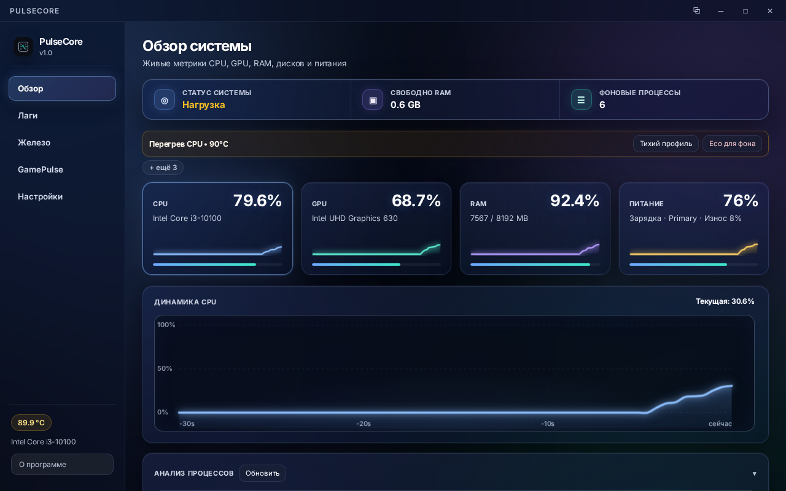
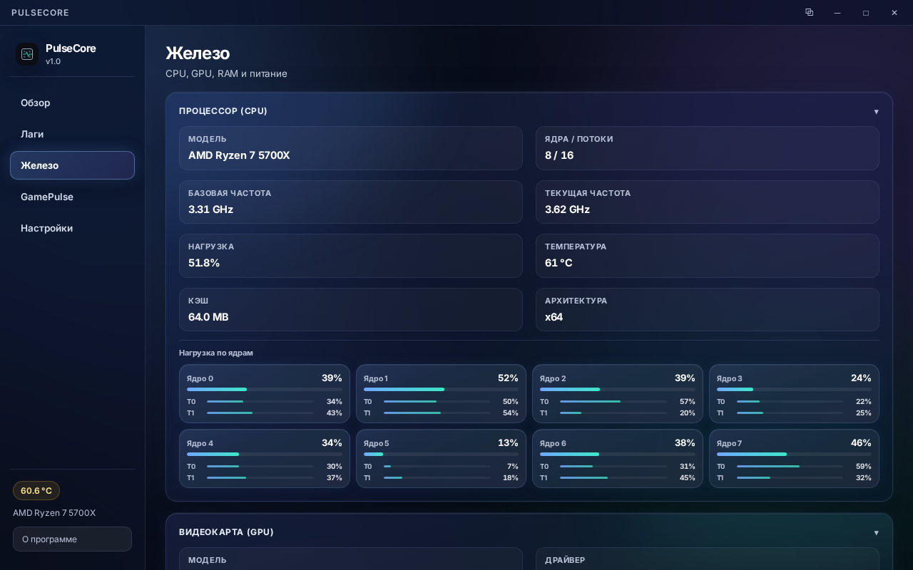
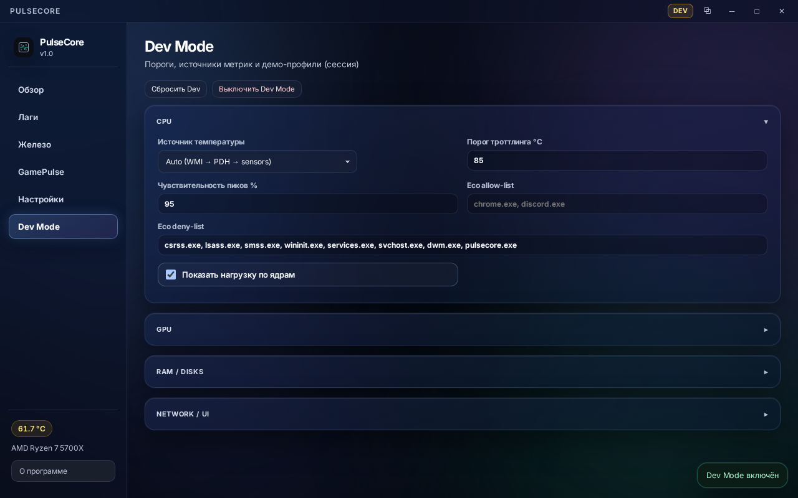
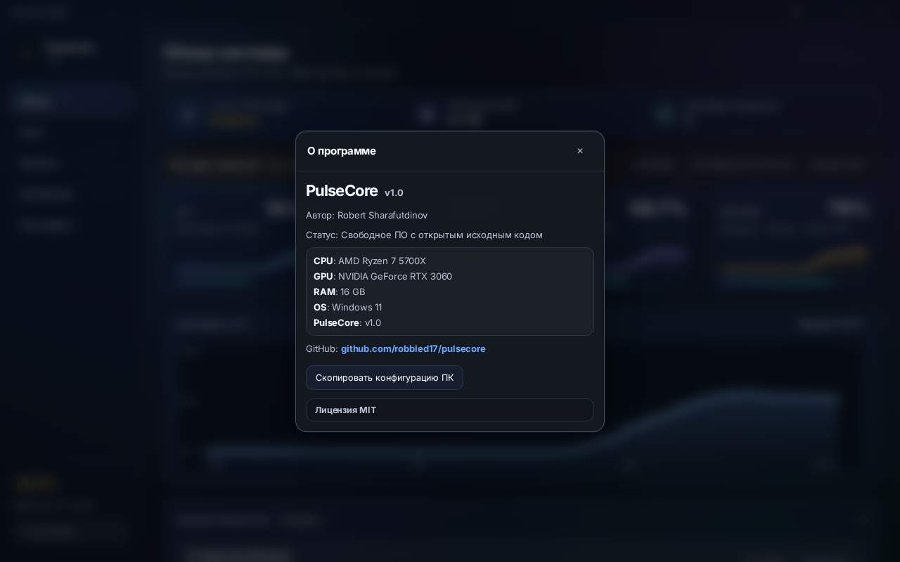
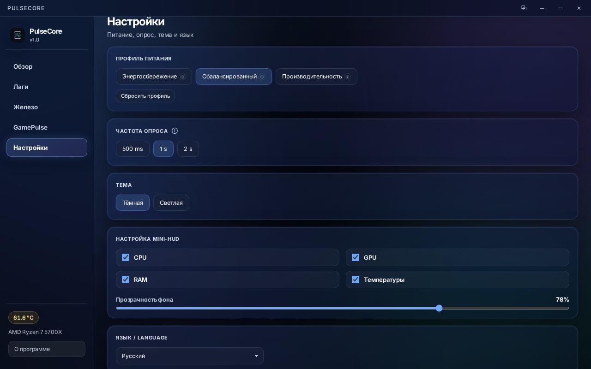
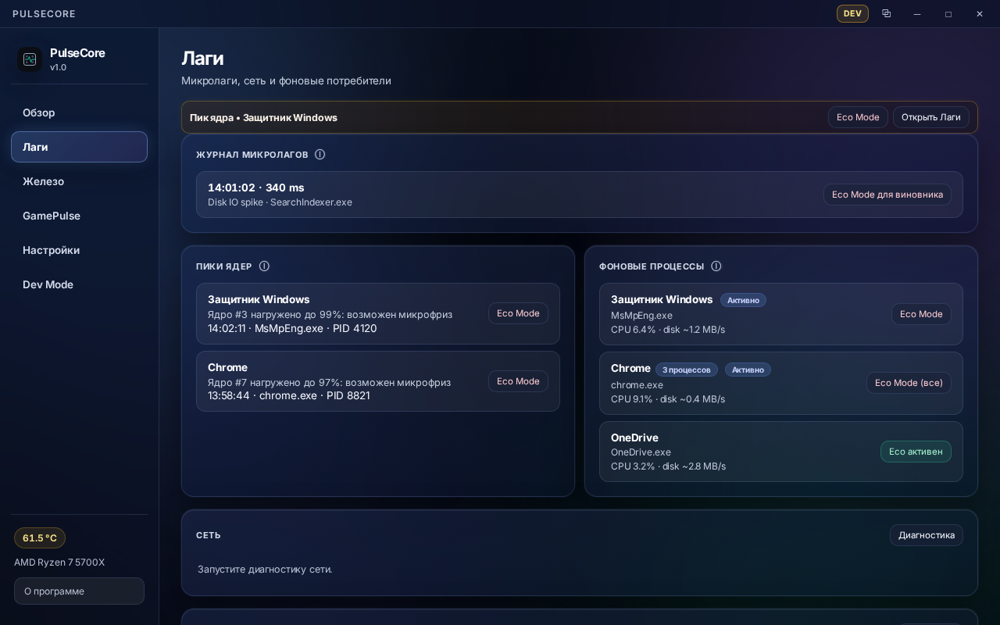
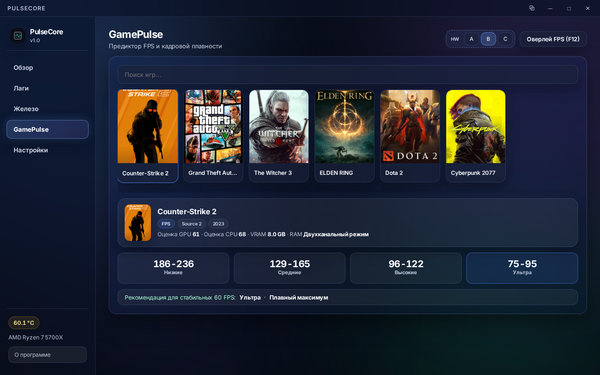

# PulseCore

**See heat. Kill lag. Play smooth.**

[](LICENSE)
[](#)
[](https://wails.io)
[](https://go.dev)
[](https://github.com/robbled17/pulsecore/releases)

PulseCore is a lightweight Windows hardware desk app: live CPU/GPU/RAM/disk metrics, lag spotting, Eco Mode for background vampires, power profiles, S.M.A.R.T., Mini-HUD, and GamePulse FPS predictions, without heavy SDKs.

## Capabilities

- **Overview**: live metrics, sparklines, actionable alerts (thermal / RAM / disk / lag)
- **Lag Spotter**: per-core spikes, stutter log, network diagnostics, sleep blockers
- **Eco Mode**: soft-limit hungry background processes (safe denylist; undo supported)
- **Hardware**: physical CPU cores with SMT thread bars, SSD S.M.A.R.T. accordion, discrete GPU preference, RAM channels, battery wear
- **Upgrade Advisor**: laptop vs desktop hard-split recommendations with free RAM slot sync
- **Smart Uninstall**: process precheck, residual scan, install tracing, Temp/Cache whitelist clean
- **GamePulse**: catalog search + FPS predictor across Low/Med/High/Ultra (~30-model HW fallback)
- **Mini-HUD**: always-on-top capsule with CPU/GPU/RAM/temps toggles
- **Power profiles**: Silent / Balanced / Turbo via Windows `powercfg`

## Screenshots















## Stack

- **Go** backend (WMI/PDH/process/power) with graceful degradation
- **Wails v2** desktop shell + WebView2
- **Vanilla JS** frontend (Vite), multi-language UI (RU default)

## Install

### From Releases

1. Download [`pulsecore.exe`](https://github.com/robbled17/pulsecore/releases/latest/download/pulsecore.exe) (or grab the zip from [Releases](https://github.com/robbled17/pulsecore/releases))
2. Optionally verify SHA256 from the matching `.sha256` asset
3. Run `pulsecore.exe`

Requires **Windows 10/11** with **WebView2** (preinstalled on modern Windows).

### Build from source

```bash
# Prerequisites: Go 1.22+, Node 18+, Wails CLI v2
go install github.com/wailsapp/wails/v2/cmd/wails@latest

cd frontend && npm install && cd ..
wails build -clean -platform windows/amd64 -ldflags "-s -w"
```

Binary: `build/bin/pulsecore.exe` (release workflow publishes bare `pulsecore.exe` plus zip).

Dev mode:

```bash
wails dev
```

Frontend-only mock UI (screenshots / demos; **not** shipped in production embed):

```bash
cd frontend && npm run dev:mock
```

## License

MIT © Robert Sharafutdinov
