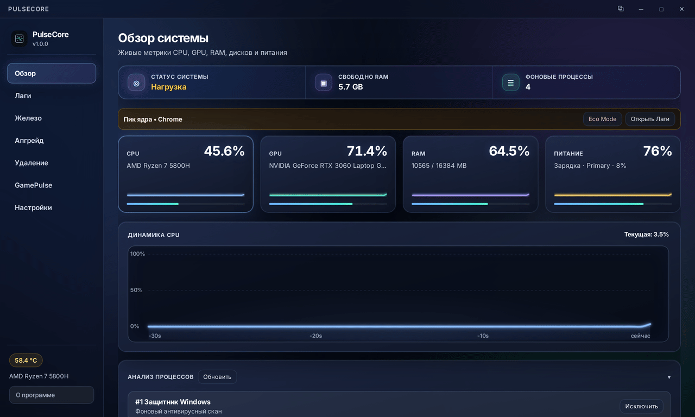
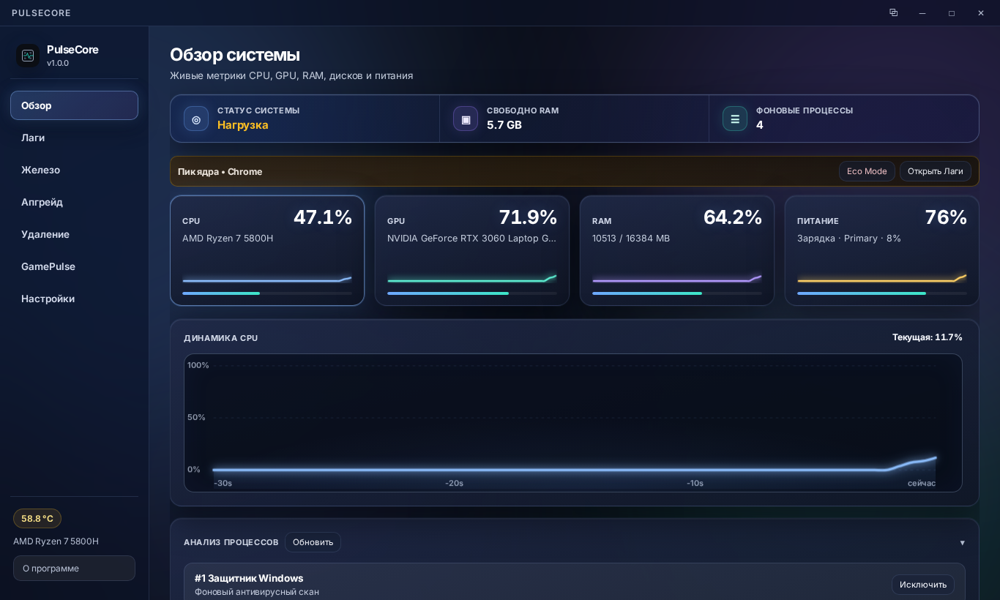
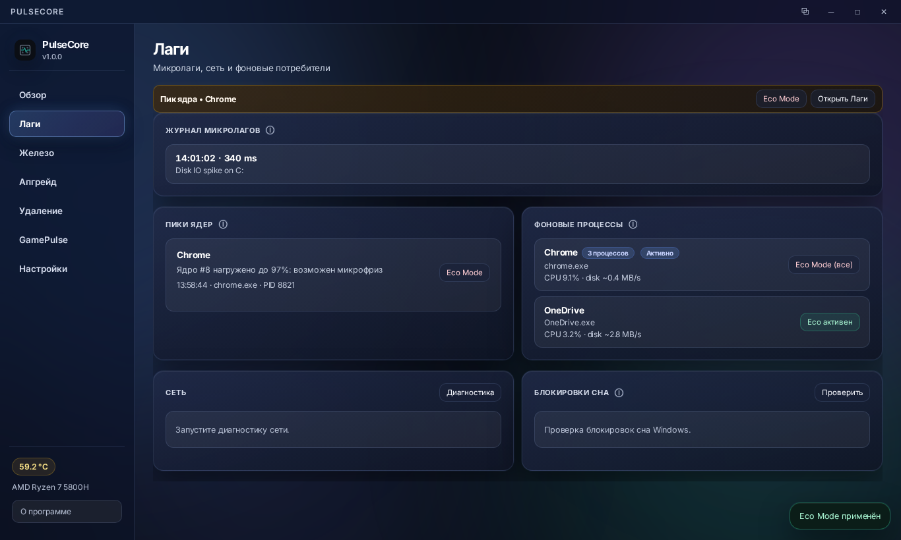
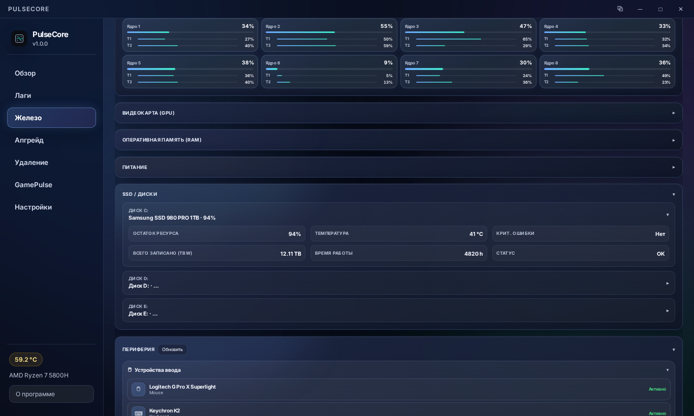
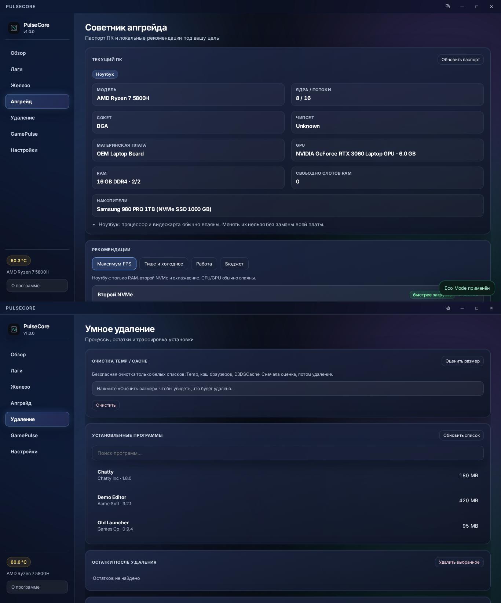
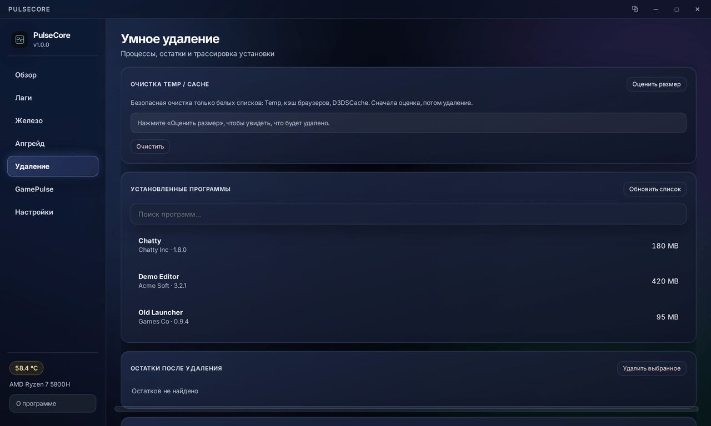
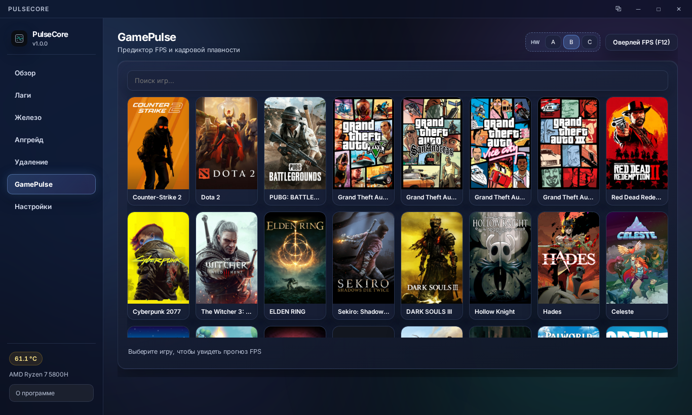

<p align="center">
  
</p>

<h1 align="center">PulseCore v1.0.0</h1>

<p align="center">
  <strong>See heat. Kill lag. Play smooth.</strong><br/>
  <em>Видишь нагрев. Убираешь лаги. Играешь плавно.</em>
</p>

<p align="center">
  <a href="https://github.com/robbled17/pulsecore/releases/tag/v1.0.0"></a>
  <a href="https://github.com/robbled17/pulsecore/releases"></a>
  <a href="#install"></a>
  <a href="#stack"></a>
  <a href="LICENSE"></a>
</p>

<p align="center">
  
</p>

<p align="center">
  <a href="https://github.com/robbled17/pulsecore/releases/latest/download/pulsecore.exe"></a>
</p>

<p align="center">
  <a href="https://robbled17.github.io/pulsecore/">Product site</a>
  ·
  <a href="https://github.com/robbled17/pulsecore/releases/latest">Releases</a>
  ·
  <a href="https://github.com/robbled17/pulsecore/releases/latest/download/SHA256SUMS.txt">SHA256SUMS.txt</a>
</p>

PulseCore is a lightweight Windows hardware desk app for gamers and power users: live CPU / GPU / RAM / disk metrics, lag spotting, Eco Mode for background vampires, power profiles, S.M.A.R.T., Mini-HUD, Upgrade Advisor, Smart Uninstall, and GamePulse FPS predictions. No heavy SDKs. No cloud account. No telemetry.

## Overview

Live metrics, sparklines, and actionable alerts for thermal, RAM, disk, and lag.



## Lag Spotter + Eco Mode

Per-core spikes, stutter log, network diagnostics, sleep blockers, and soft Eco limits for hungry background processes (safe denylist, undo supported).



## Hardware

Physical CPU cores labeled 1..N with SMT thread bars, SSD S.M.A.R.T. accordion, discrete GPU preference, RAM channels, and battery wear.



## Upgrade Advisor + Smart Uninstaller

Laptop vs desktop hard-split upgrade advice, process precheck, residual scan, install tracing, and Temp/Cache whitelist clean.



<p align="center">
  
</p>

## GamePulse

Catalog search plus FPS predictor across Low / Med / High / Ultra with a broad hardware fallback matrix.



## Safety and architecture

- Cleaner allowlist only (Temp / Cache style paths); protected OS / security processes stay untouched
- Dangerous uninstall targets are blocked; registry edits keep `.reg` backups before write
- Runs locally on your PC; no telemetry, no account, no cloud sync of personal data
- Windows elevation via embedded `requireAdministrator` when ACPI temps and full SMART need it

## Install

1. Download [`pulsecore.exe`](https://github.com/robbled17/pulsecore/releases/latest/download/pulsecore.exe)
2. Optionally verify SHA256 from [`SHA256SUMS.txt`](https://github.com/robbled17/pulsecore/releases/latest/download/SHA256SUMS.txt)
3. Run `pulsecore.exe` on **Windows 10/11** with **WebView2** (preinstalled on modern Windows)

## Build from source

For developers who want to build locally:

```bash
# Prerequisites: Go 1.22+, Node 18+, Wails CLI v2
go install github.com/wailsapp/wails/v2/cmd/wails@latest

cd frontend && npm install && cd ..
wails build -clean -platform windows/amd64 -ldflags "-s -w"
```

Binary: `build/bin/pulsecore.exe`.

## Stack

- **Go** backend (WMI / PDH / process / power) with graceful degradation
- **Wails v2** desktop shell + WebView2
- **Vanilla JS** frontend (Vite), multi-language UI (RU default)

## Author

Robert Sharafutdinov ([`robbled17`](https://github.com/robbled17))

## License

MIT © Robert Sharafutdinov
